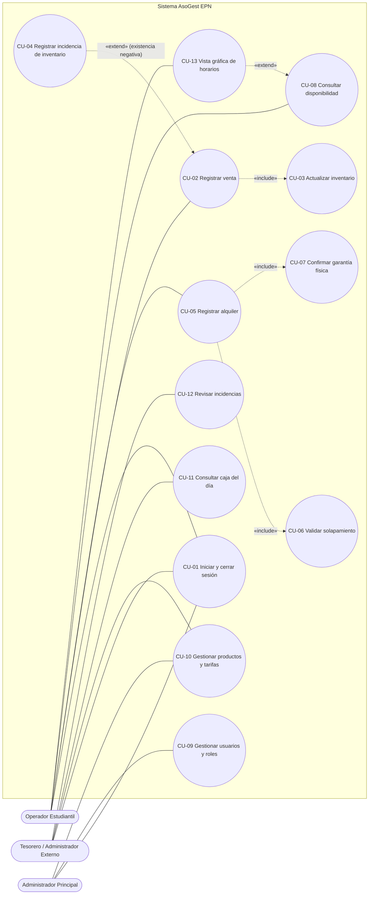

# 01. Modelo de Casos de Uso – AsoGest EPN

**Escuela Politécnica Nacional – Facultad de Ingeniería Eléctrica y Electrónica**  
**Asignatura:** Diseño y Programación de Software  
**Proyecto:** Sistema de Gestión Administrativa para las Asociaciones de Estudiantes de la EPN – Asociación de Ingeniería Química (AsoGest EPN)  
**Grupo:** C  
**Integrantes:** Jeziel Silva, Mateo Paredes y David Vega  
**Docente:** Ing. José Naranjo  
**Periodo académico:** 2026B–2027A  
**Entregable:** PPE07 – Modelado de Casos de Uso, Historias de Usuario y Priorización

---

## 1. Objetivo

Identificar los actores y los casos de uso de AsoGest EPN, y detallar el escenario de los casos de uso más complejos. Todos los casos de uso se derivan de los requerimientos refinados del Entregable 4 (PPE06) y conservan su identificación para mantener la trazabilidad.

## 2. A. Identificación de actores

| Actor | Tipo | Descripción |
|---|---|---|
| Operador Estudiantil | Persona | Atiende el mostrador de la asociación: registra ventas y alquileres, consulta la disponibilidad de los recursos y confirma la recepción de la garantía física. No puede modificar productos ni tarifas. |
| Tesorero/Administrador Externo | Persona | Revisa el resumen de caja y las incidencias de inventario. Puede crear y modificar productos y tarifas. |
| Administrador Principal | Persona | Gestiona las cuentas de usuario y sus roles, consulta el registro de sesiones y puede crear y modificar productos y tarifas. |

**Nota sobre sistemas externos.** La primera versión funciona sin conexión a Internet, con base de datos SQLite local, y no incluye pasarelas de pago, facturación electrónica ni reservas remotas (Entregable 4, sección 2). Por ello no se identifican actores de tipo sistema externo.

**Nota sobre el cliente.** Los clientes de la asociación no operan el software: sus solicitudes (compra, alquiler, consulta de horarios) se atienden por medio del Operador Estudiantil, que es quien interactúa con el sistema.

## 3. B. Listado de casos de uso

| ID | Nombre | Actor principal | Requerimientos asociados |
|---|---|---|---|
| CU-01 | Iniciar y cerrar sesión | Operador Estudiantil, Tesorero/Administrador Externo, Administrador Principal | RF-06, RNF-03 |
| CU-02 | Registrar venta | Operador Estudiantil | RF-01, RNF-01, RNF-02, RNF-04, RNF-05 |
| CU-03 | Actualizar inventario | Operador Estudiantil (incluido en CU-02) | RF-02 |
| CU-04 | Registrar incidencia de inventario | Operador Estudiantil (extiende CU-02) | RF-09, RD-02 |
| CU-05 | Registrar alquiler | Operador Estudiantil | RF-03, RD-01 |
| CU-06 | Validar solapamiento de horarios | Operador Estudiantil (incluido en CU-05) | RF-05 |
| CU-07 | Confirmar garantía física | Operador Estudiantil (incluido en CU-05) | RD-01 |
| CU-08 | Consultar disponibilidad de recursos | Operador Estudiantil | RF-04 |
| CU-09 | Gestionar usuarios y roles | Administrador Principal | RF-06, RNF-03 |
| CU-10 | Gestionar productos y tarifas | Administrador Principal, Tesorero/Administrador Externo | RF-07 |
| CU-11 | Consultar caja del día | Tesorero/Administrador Externo | RF-08 |
| CU-12 | Revisar incidencias de inventario | Tesorero/Administrador Externo | RF-09, RD-02 |
| CU-13 | Consultar vista gráfica de horarios *(iteración posterior)* | Operador Estudiantil | RF-10 |

Los requerimientos RNF-02, RNF-04 y RNF-05 son condiciones transversales (funcionamiento local, Windows Forms/.NET y SQLite) que aplican a todos los casos de uso; se asocian explícitamente solo a CU-02 como caso de referencia.

## 4. Diagrama de casos de uso (vista de referencia)

El diagrama UML formal se entrega en `02_Diagrama_Casos_Uso.png`. La siguiente vista en Mermaid resume las mismas relaciones (Mermaid no dispone de notación UML de casos de uso, por lo que los actores se representan como nodos y las relaciones `include`/`extend` como flechas rotuladas).

## 5. C. Escenarios detallados

### 5.1 CU-05 – Registrar alquiler

| Campo | Detalle |
|---|---|
| **Actor principal** | Operador Estudiantil |
| **Requerimientos** | RF-03, RF-05 (vía CU-06), RD-01 (vía CU-07) |
| **Casos de uso incluidos** | CU-06 Validar solapamiento de horarios; CU-07 Confirmar garantía física |

**Precondiciones**

1. El Operador Estudiantil ha iniciado sesión y su sesión está activa (CU-01).
2. El recurso a alquilar existe en el sistema.
3. La base de datos local SQLite está disponible.

**Flujo principal**

1. El operador selecciona la opción *Registrar alquiler*.
2. El sistema muestra el formulario de alquiler.
3. El operador ingresa el nombre del cliente, el número de cédula, selecciona el recurso e ingresa la fecha, la hora de inicio y la hora de finalización en formato HH:MM.
4. El sistema verifica que los seis datos estén completos y que las horas tengan el formato HH:MM.
5. El sistema ejecuta la validación de solapamiento (CU-06) y comprueba que el intervalo no se cruce, total ni parcialmente, con otro alquiler confirmado del mismo recurso y fecha.
6. El sistema solicita la confirmación de la garantía física (CU-07). El operador recibe el carné universitario de la EPN o la cédula de ciudadanía original y marca la recepción.
7. El sistema habilita la confirmación del alquiler.
8. El operador confirma el alquiler.
9. El sistema guarda el alquiler en la base de datos local junto con el identificador del operador, marca el intervalo como ocupado y muestra un mensaje de confirmación.

**Flujos alternativos**

- **A1. Datos incompletos o con formato inválido (paso 4).** El sistema no permite guardar el alquiler e identifica el campo pendiente o con formato incorrecto. El operador corrige el dato y el flujo continúa en el paso 4.
- **A2. Horario en conflicto (paso 5).** El sistema rechaza la confirmación e informa que el intervalo se cruza con otro alquiler confirmado. El operador modifica la fecha, el recurso o las horas, y el flujo continúa en el paso 4; o bien cancela el registro y el caso de uso termina sin guardar nada.
- **A3. Garantía no recibida (paso 6).** Si el operador no marca la recepción de un documento válido, el sistema no permite confirmar el alquiler. El operador puede solicitar la garantía al cliente y continuar en el paso 6, o cancelar el registro.
- **A4. Cancelación por el operador (pasos 3 a 8).** El operador cancela el formulario; el sistema descarta los datos ingresados y no guarda ningún registro.

**Postcondiciones**

- *Éxito:* existe un alquiler confirmado con nombre del cliente, cédula, recurso, fecha, hora de inicio, hora de finalización y operador responsable; la recepción de la garantía queda registrada; el intervalo aparece como ocupado en la consulta de disponibilidad (CU-08).
- *Fallo o cancelación:* no se guarda ningún alquiler y la disponibilidad del recurso no cambia.

### 5.2 CU-02 – Registrar venta (con extensión CU-04)

| Campo | Detalle |
|---|---|
| **Actor principal** | Operador Estudiantil |
| **Requerimientos** | RF-01, RF-02 (vía CU-03), RF-09 y RD-02 (vía CU-04), RNF-01 |
| **Casos de uso incluidos / extendidos** | Incluye CU-03 Actualizar inventario; es extendido por CU-04 Registrar incidencia de inventario |

**Precondiciones**

1. El operador tiene una sesión activa (CU-01).
2. Los productos a vender están registrados en el sistema con su precio unitario.

**Flujo principal**

1. El operador selecciona la opción *Registrar venta*.
2. El operador selecciona el primer producto e indica la cantidad; repite el paso para cada producto adicional de la venta.
3. El sistema calcula y muestra el total de la venta.
4. El operador confirma la venta.
5. El sistema registra la venta con el identificador del producto, la cantidad, el precio unitario, la fecha, la hora exacta, el total calculado y el identificador del operador con sesión activa.
6. El sistema actualiza las existencias de cada producto restando la cantidad vendida (CU-03).
7. El sistema muestra la venta en el historial.

**Flujos alternativos**

- **A1. Existencias insuficientes (paso 6).** Si la cantidad vendida supera el stock registrado, el sistema completa la venta de todas formas, deja el saldo de existencias en valor negativo y ejecuta CU-04: registra una incidencia con el producto afectado, la cantidad involucrada, la fecha, la hora y el usuario responsable, para revisión del Tesorero/Administrador Externo.
- **A2. Cancelación antes de confirmar (pasos 2 a 4).** El operador cancela; el sistema descarta la selección y no modifica ventas ni existencias.

**Postcondiciones**

- *Éxito:* la venta queda registrada y visible en el historial; las existencias disminuyen exactamente en la cantidad vendida; si el resultado fue negativo, existe una incidencia consultable (CU-12).
- *Cancelación:* no se registra venta ni se modifica el inventario.

---
**Fin del documento 01_Modelo_Casos_Uso.md**
