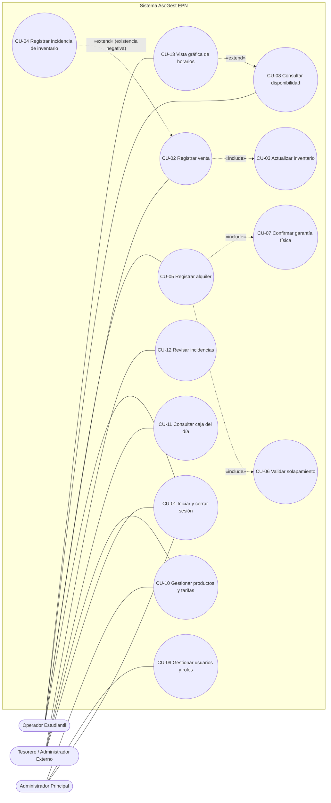

# Especificación de Requerimientos de Software (SRS) – AsoGest EPN

**Escuela Politécnica Nacional – Facultad de Ingeniería Eléctrica y Electrónica**  
**Asignatura:** Diseño y Programación de Software  
**Proyecto:** Sistema de Gestión Administrativa para las Asociaciones de Estudiantes de la EPN – Asociación de Ingeniería Química (AsoGest EPN)  
**Grupo:** C  
**Integrantes:** Jeziel Silva, Mateo Paredes y David Vega  
**Docente:** Ing. José Naranjo  
**Periodo académico:** 2026B–2027A  
**Entregable:** PPE08 – Matriz de Trazabilidad, Validación y Cierre de la IR

**Versión del documento:** v1.0

---

## Contenido

1. Introducción
2. Descripción general
3. Requerimientos funcionales
4. Requerimientos no funcionales
5. Requerimientos de dominio
6. Modelo de casos de uso
7. Historias de usuario y criterios de aceptación
8. Matriz de priorización MoSCoW
9. Matriz de trazabilidad
10. Resultados de validación
11. Control de versiones
12. Puntos abiertos

---

## 1. Introducción

### 1.1 Propósito

Este documento especifica los requerimientos de AsoGest EPN en su versión consolidada al cierre de la fase de Ingeniería de Requerimientos. Integra el catálogo y el refinamiento de requerimientos, el modelo de casos de uso, las historias de usuario, la priorización MoSCoW, la trazabilidad y los resultados de validación. Sirve de referencia para el diseño, la programación y las pruebas del sistema, y está dirigido al equipo de desarrollo (Grupo C), al docente y a los interesados de la asociación.

### 1.2 Alcance

AsoGest EPN es una aplicación de escritorio que apoya la administración de ventas, inventario, alquileres, usuarios y caja de la Asociación de Estudiantes de Ingeniería Química de la EPN. Reemplaza el registro actual en hojas de cálculo y anotaciones en papel.

**Incluido en la primera versión:** registro de ventas con actualización de inventario e incidencias; registro de alquileres con garantía física y validación de horarios; consulta de disponibilidad mediante listado; administración de usuarios, roles, productos y tarifas; consulta de caja en pantalla; inicio y cierre de sesión.

**Excluido de la primera versión (Won't):** exportación automática de reportes a Excel, aplicaciones móviles, reservas remotas, pasarelas de pago y facturación electrónica, cálculo automático de multas por mora o daños (se gestiona manualmente según el reglamento de la asociación) e integración con sistemas institucionales de la EPN (SAEw y Decanato). La vista gráfica tipo calendario (RF-10) se difiere a una iteración posterior.

### 1.3 Definiciones y abreviaturas

| Término | Definición |
|---|---|
| AsoGest EPN | Sistema de Gestión Administrativa para las Asociaciones de Estudiantes de la EPN. |
| SRS | Software Requirements Specification: Especificación de Requerimientos de Software. |
| IR | Ingeniería de Requerimientos. |
| RF / RNF / RD | Requerimiento Funcional / No Funcional / de Dominio. |
| CU | Caso de uso. |
| HU | Historia de usuario. |
| MoSCoW | Técnica de priorización: Must (indispensable), Should (importante), Could (deseable), Won't (fuera de esta versión). |
| Operador Estudiantil | Estudiante que atiende el mostrador y opera el sistema. |
| Tesorero/Administrador Externo | Perfil que revisa caja e incidencias y gestiona productos y tarifas. |
| Administrador Principal | Perfil (Presidente de la Asociación) que gestiona cuentas, roles y sesiones, y también productos y tarifas. |
| Administrador Externo | Gestor permanente o tesorero designado que supervisa la contabilidad, el arqueo de caja y el cumplimiento normativo. |
| Recurso / insumo | Bien reutilizable o espacio de entretenimiento propiedad de la asociación (mandiles, puntas de prueba, material de laboratorio, consolas de videojuegos, mesas de billar o ping-pong, casilleros), disponible por bloques horarios. |
| Garantía física | Carné universitario de la EPN o cédula de ciudadanía original que el operador recibe y retiene temporalmente durante un alquiler. |
| Existencias (stock) | Cantidad registrada de unidades de un producto. |
| Existencia negativa | Saldo de stock menor que cero, resultante de vender más unidades que las registradas. |
| Incidencia de inventario | Registro generado por una venta con existencias negativas, para revisión del Tesorero/Administrador Externo. |
| Solapamiento | Intersección temporal, total o parcial, entre los intervalos de dos alquileres del mismo recurso y fecha. Los intervalos contiguos (el fin de uno coincide con el inicio de otro) no se consideran solapamiento. |
| Aso / Asociación | Asociación de Estudiantes de la EPN (por ejemplo, Ingeniería Química), que administra la venta de productos y el alquiler de recursos. |
| Producto comercial | Artículo de consumo o papelería (alimentos, bebidas, copias, útiles) sujeto a control de existencias. |
| Cuadre / arqueo de caja | Conciliación diaria entre el dinero físico recaudado en el mostrador y los registros digitales de cada operador durante su turno. |
| RBAC | Role-Based Access Control: control de acceso basado en roles, que restringe permisos según el perfil autenticado. |
| Hash | Valor resultante de una función hash; no permite recuperar la contraseña original. |
| SHA-256 | Función hash mencionada en la documentación anterior; su uso definitivo está pendiente de validación técnica (RNF-03). |
| HH:MM | Formato de hora de 24 horas con horas y minutos. |
| SQLite | Base de datos relacional local sin servidor. |
| Windows Forms | Tecnología de interfaz de escritorio de .NET. |

### 1.4 Referencias

- Grupo C. *01_Vision_y_Alcance – Documento de Visión y Alcance del Sistema AsoGest EPN*, 21 de noviembre de 2026.
- Grupo C. *02_Matriz_Interesados – Matriz de Interesados*, 21 de noviembre de 2026.
- PPE05 – Catálogo de Requerimientos y Análisis de Refinamiento (01_Catalogo_Requerimientos.md, 02_Informe_Analisis_Refinamiento.md).
- PPE06 – Requerimientos Refinados y Verificables (01_Requerimientos_Refinados.md).
- PPE07 – Modelado de Casos de Uso, Historias de Usuario y Priorización (01_Modelo_Casos_Uso.md, 03_Historias_Usuario.md, 04_Matriz_Priorizacion_MoSCoW.md).
- PPE08 – Matriz de Trazabilidad, Validación y Cierre de la IR.

### 1.5 Organización del documento

Las secciones 3 a 5 contienen los requerimientos refinados; las secciones 6 a 8 los modelos y la priorización; las secciones 9 a 11 la trazabilidad, la validación y el control de versiones; la sección 12 los puntos abiertos.

---

## 2. Descripción general

### 2.1 Contexto del negocio

En la Escuela Politécnica Nacional, las asociaciones estudiantiles, gestionadas por alumnos o administradores externos, comercializan productos de consumo (alimentos, bebidas, copias y útiles) y administran el alquiler temporal de recursos e instalaciones (mandiles, puntas de prueba, material de laboratorio, consolas de videojuegos, mesas de billar o ping-pong y casilleros).

El registro se realiza actualmente mediante hojas de cálculo y anotaciones en papel, lo que genera inconsistencias contables, descuadres de caja, retrasos en horas pico, traslape de turnos sin cierre de sesión individual y, en ocasiones, dobles reservas o inconsistencias en las horas. AsoGest EPN centraliza las operaciones de mostrador, administra productos y usuarios, registra alquileres y garantías, permite consultar la disponibilidad de recursos y revisar la caja. La solución es una aplicación de escritorio con Windows Forms, C# y .NET 8 o superior, con almacenamiento local en SQLite.

### 2.2 Interesados y actores

| Interesado | Clasificación | Interés | Influencia | Necesidad principal | Posibles conflictos |
|---|---|---|---|---|---|
| Presidente de la Asociación (perfil Administrador Principal) | Interno / Directo | Alto | Alta | Control centralizado del catálogo, las tarifas, la gestión de usuarios y roles y los reportes institucionales. | Exige restringir la modificación de precios y usuarios a perfiles directivos, lo que puede ralentizar correcciones urgentes en mostrador. |
| Tesorero / Administrador Externo | Interno / Directo | Alto | Alta | Gestión de catálogo y tarifas (junto al Presidente), auditoría, cuadre de caja diario, trazabilidad por operador y control de incidencias de stock. | Demanda controles rígidos de autorización y auditoría de saldos negativos, lo que choca con la agilidad que exigen los operadores en horas pico. |
| Estudiantes operadores | Interno / Directo | Alto | Media | Interfaz de menos de 10 s por venta, registro ágil de ventas y alquileres sin hojas sueltas y facilidad de cierre de turno. | Priorizan la velocidad en los recesos sobre las validaciones estrictas, los controles de auditoría y los cierres de sesión individuales. |
| Estudiantes (clientes EPN) | Externo / Directo | Medio | Media | Visualización clara de horarios disponibles, tiempos de espera mínimos y cobros justos. | Desean flexibilidad en los tiempos de uso o alquilar sin portar el carné, lo que contraviene la regla de garantía (RD-01). |
| Decanato / Autoridades EPN | Externo / Indirecto | Medio | Media | Transparencia contable, cumplimiento normativo y seguridad de la información local. | Solicita informes formales y respaldo seguro de datos, mientras la directiva prioriza la simplicidad operativa. |
| Proveedores | Externo / Indirecto | Bajo | Baja | Comprobantes claros de recepción de mercadería e ingresos de inventario. | Pueden requerir registros de recepción que exceden el flujo básico de ventas de la primera versión. |

Además participan el Personal de T.I. (fuente de RNF-02 y RNF-05), el Responsable de Seguridad (fuente de RNF-03) y el docente, Ing. José Naranjo, quien revisa y aprueba los entregables.

Los actores del sistema son tres: Operador Estudiantil, Tesorero/Administrador Externo y Administrador Principal (véase la sección 6.1). Los clientes no operan el software y no existen actores de tipo sistema externo.

#### 2.2.1 Conflictos entre interesados y estrategia de resolución

1. **Agilidad operativa frente a control y auditoría.** Los operadores, rotativos y de tiempo parcial, deben despachar filas en menos de 10 segundos sin frenar ventas por desfases de inventario; el Tesorero y el Presidente exigen auditoría, trazabilidad individual, bloqueo de cambios de precios y control de inventario. Se resolvió con control de acceso basado en roles en dos niveles: un modo operativo ágil para el operador (ventas sin bloqueo por stock, con saldo negativo e incidencia automática) y un modo de administración y auditoría para el Presidente y el Tesorero.
2. **Flexibilidad al cliente frente a cumplimiento normativo.** Los clientes buscan acceder a recursos aunque olviden su documento; el reglamento exige retener el carné de la EPN o la cédula original. Se resolvió automatizando la validación de recepción de la garantía en el formulario de alquiler (RD-01).
3. **Acuerdos de alcance.** El Tesorero aceptó aplazar la exportación a Excel a cambio de consultar el cierre de caja diario en pantalla, detallado por operador; los operadores aceptaron un listado de horarios en lugar de un calendario visual, siempre que el sistema bloquee cualquier cruce de reservas.

### 2.3 Restricciones

1. **Tecnológica y de plataforma:** software de escritorio con Windows Forms, C# y .NET 8 o superior, ejecutado en la computadora del mostrador (RNF-04).
2. **Conectividad y almacenamiento:** operación local sin depender de Internet ni de servidores en la nube, con base de datos relacional embebida SQLite (RNF-02, RNF-05). El documento de Visión y Alcance deja abierta la posibilidad de migrar a MySQL o PostgreSQL en el futuro.
3. **Rendimiento en mostrador:** registro de una venta en 10 segundos o menos (RNF-01).
4. **Normativa y seguridad:** no se autoriza ningún alquiler sin confirmar la recepción de la garantía física (RD-01); las contraseñas no se almacenan en texto plano (RNF-03).
5. **Presupuesto y tiempo:** el desarrollo debe completarse dentro del periodo académico 2026B–2027A por los tres integrantes del Grupo C, sin costos de licenciamiento de software propietario ni hardware adicional.
6. **Alcance:** las exclusiones de la sección 1.2.

### 2.4 Dependencias entre requerimientos

Las principales dependencias son: RF-02 depende de RF-01; RF-09 de RF-01 y RF-02; RF-05 de RF-03 y RF-04; RF-10 de RF-03, RF-04 y RF-05; RF-07 de RF-06; RF-08 de RF-01 y RF-06; RF-06 de RNF-03; RF-03 de RD-01. Las funciones principales dependen de RNF-02, RNF-04 y RNF-05. El detalle está en cada ficha de requerimiento.

---

## 3. Requerimientos funcionales (versión refinada)

### RF-01 – Registro de ventas

- **Enunciado:** El sistema deberá registrar cada venta con el identificador del producto, la cantidad, el precio unitario, la fecha, la hora, el total calculado y el identificador del operador con sesión activa.
- **Fuente:** Estudiantes operadores; registro I-03; documento de Visión y Alcance, sección 2.1.
- **Prioridad:** Must
- **Criterio de aceptación:** Al confirmar una venta, el sistema guarda todos los datos indicados y muestra la venta en el historial. El total almacenado coincide con la suma de los precios unitarios multiplicados por sus cantidades.
- **Dependencias:** Ninguna.

### RF-02 – Actualización del inventario

- **Enunciado:** El sistema deberá actualizar las existencias de cada producto al confirmar una venta, restando la cantidad vendida de la existencia registrada.
- **Fuente:** Tesorero/Administrador Externo; Matriz de Interesados, sección 3.2; documento de Visión y Alcance, sección 2.1.
- **Prioridad:** Must
- **Criterio de aceptación:** Después de confirmar una venta, la existencia del producto disminuye exactamente en la cantidad vendida. Si el resultado es negativo, la venta se completa y el saldo negativo queda registrado.
- **Dependencias:** RF-01.

### RF-03 – Registro de alquileres

- **Enunciado:** El sistema deberá registrar cada alquiler con el nombre del cliente, número de cédula, identificador del recurso, fecha, hora de inicio y hora de finalización en formato HH:MM.
- **Fuente:** Operadores y clientes; registro I-04; formato actual de alquileres.
- **Prioridad:** Must
- **Criterio de aceptación:** Al guardar un alquiler, el registro contiene los seis datos solicitados. Si falta uno de ellos, el sistema impide guardar el alquiler e identifica el campo pendiente.
- **Dependencias:** RD-01.

### RF-04 – Consulta de disponibilidad

- **Enunciado:** El sistema deberá mostrar, mediante un listado, los horarios libres y ocupados de cada recurso para la fecha seleccionada.
- **Fuente:** Estudiantes clientes y operadores; registro I-05; documento de Visión y Alcance, sección 2.1.
- **Prioridad:** Must
- **Criterio de aceptación:** Al seleccionar una fecha y un recurso, el sistema presenta un listado que identifica los intervalos ocupados y los intervalos disponibles para esa fecha.
- **Dependencias:** RF-03.

### RF-05 – Validación de horarios

- **Enunciado:** El sistema deberá impedir la confirmación de un alquiler cuando su intervalo de tiempo se cruce total o parcialmente con otro alquiler confirmado para el mismo recurso y fecha.
- **Fuente:** Estudiantes operadores; registro I-05; definición de solapamiento del documento de Visión y Alcance.
- **Prioridad:** Must
- **Criterio de aceptación:** Al intentar confirmar un alquiler que comparte cualquier parte de su intervalo con otro alquiler confirmado del mismo recurso y fecha, el sistema rechaza la confirmación. Un intervalo sin cruce puede confirmarse si cumple las demás condiciones.
- **Dependencias:** RF-03, RF-04.
- **Aclaración (v1.0):** Los intervalos contiguos (el fin de un alquiler coincide con el inicio de otro para el mismo recurso y fecha) no se consideran solapamiento y pueden confirmarse.

### RF-06 – Administración de usuarios

- **Enunciado:** El sistema deberá permitir al Administrador Principal crear, modificar y suspender cuentas de usuario, asignar roles y registrar los inicios y cierres de sesión.
- **Fuente:** Presidente de la Asociación; registro I-07; Matriz de Interesados.
- **Prioridad:** Must
- **Criterio de aceptación:** El Administrador Principal puede crear, editar y suspender una cuenta, asignar un rol y consultar el registro de inicios y cierres de sesión. Un usuario sin ese perfil no puede ejecutar esas acciones.
- **Dependencias:** RNF-03.

### RF-07 – Administración de productos y tarifas

- **Enunciado:** El sistema deberá permitir la creación y modificación de productos y tarifas únicamente a los perfiles Administrador Principal y Tesorero/Administrador Externo.
- **Fuente:** Presidente y Tesorero/Administrador Externo; registro I-06; documento de Visión y Alcance, sección 2.1.
- **Prioridad:** Must
- **Criterio de aceptación:** Los perfiles Administrador Principal y Tesorero/Administrador Externo pueden crear y modificar productos y tarifas. El perfil Operador Estudiantil no puede realizar esas acciones.
- **Dependencias:** RF-06.

### RF-08 – Consulta de caja

- **Enunciado:** El sistema deberá mostrar en pantalla el resumen de caja del día y los movimientos registrados por turno y operador.
- **Fuente:** Tesorero/Administrador Externo; documento de Visión y Alcance, sección 2.1 y exclusiones de la sección 2.2.
- **Prioridad:** Must
- **Criterio de aceptación:** Al consultar una fecha, el sistema muestra el resumen de caja y los movimientos asociados, agrupados por turno y operador. La primera versión no genera archivos de Excel.
- **Dependencias:** RF-01, RF-06.

### RF-09 – Registro de incidencias de inventario

- **Enunciado:** El sistema deberá registrar una incidencia cuando una venta produzca existencias negativas, incluyendo el producto afectado, la cantidad involucrada, la fecha, la hora y el usuario responsable.
- **Fuente:** Tesorero/Administrador Externo; Matriz de Interesados, sección 2; documento de Visión y Alcance, sección 2.1.
- **Prioridad:** Must
- **Criterio de aceptación:** Al confirmar una venta que deja existencias negativas, el sistema crea una incidencia que contiene los cinco datos indicados y permite que el responsable administrativo la consulte.
- **Dependencias:** RF-01, RF-02, RD-02.

### RF-10 – Vista gráfica de horarios

- **Enunciado:** En una iteración posterior, el sistema deberá mostrar en una vista gráfica tipo calendario los intervalos libres y ocupados de cada recurso.
- **Fuente:** Clientes y operadores; registro I-05; documento de Visión y Alcance, sección 2.1.
- **Prioridad:** Could
- **Criterio de aceptación:** En la iteración que incluya esta mejora, al seleccionar un recurso y una fecha, el calendario representa los intervalos libres y ocupados y coincide con los datos consultados mediante el listado. Esta función no es obligatoria para la primera versión.
- **Dependencias:** RF-03, RF-04, RF-05.

## 4. Requerimientos no funcionales (versión refinada)

### RNF-01 – Tiempo de respuesta en ventas

- **Enunciado:** La interfaz deberá permitir completar el registro de una venta de hasta tres productos en un tiempo igual o inferior a 10 segundos, medido desde la selección del primer producto hasta la confirmación.
- **Fuente:** Estudiantes operadores; declaración 3 de adquisición; documento de Visión y Alcance, sección 3.
- **Prioridad:** Must
- **Criterio de aceptación:** En una prueba con hasta tres productos, el tiempo transcurrido entre la selección del primer producto y la confirmación de la venta es de 10 segundos o menos.
- **Dependencias:** RF-01.

### RNF-02 – Funcionamiento local

- **Enunciado:** El sistema deberá permitir realizar las operaciones principales desde la computadora del mostrador sin depender de una conexión a Internet.
- **Fuente:** Personal de T.I. y Decanato; registro I-01; documento de Visión y Alcance, sección 3.
- **Prioridad:** Must
- **Criterio de aceptación:** Con la conexión a Internet desactivada, el usuario puede iniciar el sistema y ejecutar las operaciones principales definidas para la primera versión utilizando los datos locales.
- **Dependencias:** RNF-04, RNF-05.

### RNF-03 – Protección de credenciales

- **Enunciado:** El sistema deberá almacenar las contraseñas únicamente mediante valores hash y no deberá conservar contraseñas en texto plano.
- **Fuente:** Responsable de Seguridad; documento de Visión y Alcance, secciones 2.1 y 3; observación del análisis del Entregable 3.
- **Prioridad:** Must
- **Criterio de aceptación:** Al revisar los datos almacenados, no se encuentran contraseñas en texto plano. Durante el inicio de sesión, el sistema verifica la contraseña ingresada mediante el mecanismo de hashing definido para el proyecto. La selección técnica definitiva del algoritmo queda pendiente de validación.
- **Dependencias:** RF-06.

### RNF-04 – Tecnología de desarrollo

- **Enunciado:** La aplicación deberá implementarse como software de escritorio utilizando Windows Forms con C# y .NET 8 o superior.
- **Fuente:** Restricción tecnológica del proyecto; documento de Visión y Alcance, sección 3.
- **Prioridad:** Must
- **Criterio de aceptación:** La solución compila y se ejecuta como aplicación Windows Forms desarrollada en C# sobre .NET 8 o una versión superior.
- **Dependencias:** Ninguna.

### RNF-05 – Almacenamiento local

- **Enunciado:** El sistema deberá almacenar la información operativa en una base de datos relacional local SQLite, sin requerir servidores en la nube para la primera versión.
- **Fuente:** Personal de T.I.; documento de Visión y Alcance, sección 3.
- **Prioridad:** Must
- **Criterio de aceptación:** Al ejecutar las operaciones principales, los registros se guardan y se recuperan desde una base de datos SQLite local. El funcionamiento de la primera versión no requiere conexión a un servidor en la nube.
- **Dependencias:** RNF-02.

## 5. Requerimientos de dominio

### RD-01 – Garantía física obligatoria

- **Enunciado:** El sistema deberá impedir la confirmación de un alquiler hasta que el operador registre la recepción física del carné universitario de la EPN o de la cédula de ciudadanía original como garantía.
- **Fuente:** Reglamento interno de la Asociación; Presidente; Matriz de Interesados, sección 3.2.
- **Prioridad:** Must
- **Criterio de aceptación:** Si el operador no marca la recepción de uno de los documentos válidos, el sistema no confirma el alquiler. Cuando registra la recepción, el sistema permite continuar si se cumplen las demás condiciones.
- **Dependencias:** RF-03.

### RD-02 – Control de existencias negativas

- **Enunciado:** El sistema deberá identificar como incidencia cada movimiento de venta que genere existencias negativas para su revisión por el Tesorero/Administrador Externo.
- **Fuente:** Acuerdo operativo descrito en la Matriz de Interesados, sección 3.2; documento de Visión y Alcance, sección 2.1.
- **Prioridad:** Must
- **Criterio de aceptación:** Cada venta que produzca una existencia negativa queda asociada a una incidencia consultable por el Tesorero/Administrador Externo.
- **Dependencias:** RF-02, RF-09.

---

## 6. Modelo de casos de uso

### 6.1 Actores

| Actor | Tipo | Descripción |
|---|---|---|
| Operador Estudiantil | Persona | Atiende el mostrador de la asociación: registra ventas y alquileres, consulta la disponibilidad de los recursos y confirma la recepción de la garantía física. No puede modificar productos ni tarifas. |
| Tesorero/Administrador Externo | Persona | Revisa el resumen de caja y las incidencias de inventario. Puede crear y modificar productos y tarifas. |
| Administrador Principal | Persona | Gestiona las cuentas de usuario y sus roles, consulta el registro de sesiones y puede crear y modificar productos y tarifas. |

**Nota sobre sistemas externos.** La primera versión funciona sin conexión a Internet, con base de datos SQLite local, y no incluye pasarelas de pago, facturación electrónica ni reservas remotas (Entregable 4, sección 2). Por ello no se identifican actores de tipo sistema externo.

**Nota sobre el cliente.** Los clientes de la asociación no operan el software: sus solicitudes (compra, alquiler, consulta de horarios) se atienden por medio del Operador Estudiantil, que es quien interactúa con el sistema.

### 6.2 Listado de casos de uso

| ID | Nombre | Actor principal | Requerimientos asociados |
|---|---|---|---|
| CU-01 | Iniciar y cerrar sesión | Operador Estudiantil, Tesorero/Administrador Externo, Administrador Principal | RF-06, RNF-03 |
| CU-02 | Registrar venta | Operador Estudiantil | RF-01, RNF-01, RNF-02, RNF-04, RNF-05 |
| CU-03 | Actualizar inventario | Operador Estudiantil (incluido en CU-02) | RF-02 |
| CU-04 | Registrar incidencia de inventario | Operador Estudiantil (extiende CU-02) | RF-09, RD-02 |
| CU-05 | Registrar alquiler | Operador Estudiantil | RF-03, RD-01 |
| CU-06 | Validar solapamiento de horarios | Operador Estudiantil (incluido en CU-05) | RF-05 |
| CU-07 | Confirmar garantía física | Operador Estudiantil (incluido en CU-05) | RD-01 |
| CU-08 | Consultar disponibilidad de recursos | Operador Estudiantil | RF-04 |
| CU-09 | Gestionar usuarios y roles | Administrador Principal | RF-06, RNF-03 |
| CU-10 | Gestionar productos y tarifas | Administrador Principal, Tesorero/Administrador Externo | RF-07 |
| CU-11 | Consultar caja del día | Tesorero/Administrador Externo | RF-08 |
| CU-12 | Revisar incidencias de inventario | Tesorero/Administrador Externo | RF-09, RD-02 |
| CU-13 | Consultar vista gráfica de horarios *(iteración posterior)* | Operador Estudiantil | RF-10 |

Los requerimientos RNF-02, RNF-04 y RNF-05 son condiciones transversales (funcionamiento local, Windows Forms/.NET y SQLite) que aplican a todos los casos de uso; se asocian explícitamente solo a CU-02 como caso de referencia.

### 6.3 Diagrama de casos de uso

*Figura 1. Diagrama de casos de uso del Sistema AsoGest EPN. Las líneas punteadas representan relaciones «include» y «extend»; el caso CU-13 corresponde a una iteración posterior.*

Vista de referencia equivalente en Mermaid:

### 6.4 Escenarios de los casos de uso principales

#### 6.4.1 CU-05 – Registrar alquiler

| Campo | Detalle |
|---|---|
| **Actor principal** | Operador Estudiantil |
| **Requerimientos** | RF-03, RF-05 (vía CU-06), RD-01 (vía CU-07) |
| **Casos de uso incluidos** | CU-06 Validar solapamiento de horarios; CU-07 Confirmar garantía física |

**Precondiciones**

1. El Operador Estudiantil ha iniciado sesión y su sesión está activa (CU-01).
2. El recurso a alquilar existe en el sistema.
3. La base de datos local SQLite está disponible.

**Flujo principal**

1. El operador selecciona la opción *Registrar alquiler*.
2. El sistema muestra el formulario de alquiler.
3. El operador ingresa el nombre del cliente, el número de cédula, selecciona el recurso e ingresa la fecha, la hora de inicio y la hora de finalización en formato HH:MM.
4. El sistema verifica que los seis datos estén completos y que las horas tengan el formato HH:MM.
5. El sistema ejecuta la validación de solapamiento (CU-06) y comprueba que el intervalo no se cruce, total ni parcialmente, con otro alquiler confirmado del mismo recurso y fecha.
6. El sistema solicita la confirmación de la garantía física (CU-07). El operador recibe el carné universitario de la EPN o la cédula de ciudadanía original y marca la recepción.
7. El sistema habilita la confirmación del alquiler.
8. El operador confirma el alquiler.
9. El sistema guarda el alquiler en la base de datos local junto con el identificador del operador, marca el intervalo como ocupado y muestra un mensaje de confirmación.

**Flujos alternativos**

- **A1. Datos incompletos o con formato inválido (paso 4).** El sistema no permite guardar el alquiler e identifica el campo pendiente o con formato incorrecto. El operador corrige el dato y el flujo continúa en el paso 4.
- **A2. Horario en conflicto (paso 5).** El sistema rechaza la confirmación e informa que el intervalo se cruza con otro alquiler confirmado. El operador modifica la fecha, el recurso o las horas, y el flujo continúa en el paso 4; o bien cancela el registro y el caso de uso termina sin guardar nada.
- **A3. Garantía no recibida (paso 6).** Si el operador no marca la recepción de un documento válido, el sistema no permite confirmar el alquiler. El operador puede solicitar la garantía al cliente y continuar en el paso 6, o cancelar el registro.
- **A4. Cancelación por el operador (pasos 3 a 8).** El operador cancela el formulario; el sistema descarta los datos ingresados y no guarda ningún registro.

**Postcondiciones**

- *Éxito:* existe un alquiler confirmado con nombre del cliente, cédula, recurso, fecha, hora de inicio, hora de finalización y operador responsable; la recepción de la garantía queda registrada; el intervalo aparece como ocupado en la consulta de disponibilidad (CU-08).
- *Fallo o cancelación:* no se guarda ningún alquiler y la disponibilidad del recurso no cambia.

#### 6.4.2 CU-02 – Registrar venta (con extensión CU-04)

| Campo | Detalle |
|---|---|
| **Actor principal** | Operador Estudiantil |
| **Requerimientos** | RF-01, RF-02 (vía CU-03), RF-09 y RD-02 (vía CU-04), RNF-01 |
| **Casos de uso incluidos / extendidos** | Incluye CU-03 Actualizar inventario; es extendido por CU-04 Registrar incidencia de inventario |

**Precondiciones**

1. El operador tiene una sesión activa (CU-01).
2. Los productos a vender están registrados en el sistema con su precio unitario.

**Flujo principal**

1. El operador selecciona la opción *Registrar venta*.
2. El operador selecciona el primer producto e indica la cantidad; repite el paso para cada producto adicional de la venta.
3. El sistema calcula y muestra el total de la venta.
4. El operador confirma la venta.
5. El sistema registra la venta con el identificador del producto, la cantidad, el precio unitario, la fecha, la hora exacta, el total calculado y el identificador del operador con sesión activa.
6. El sistema actualiza las existencias de cada producto restando la cantidad vendida (CU-03).
7. El sistema muestra la venta en el historial.

**Flujos alternativos**

- **A1. Existencias insuficientes (paso 6).** Si la cantidad vendida supera el stock registrado, el sistema completa la venta de todas formas, deja el saldo de existencias en valor negativo y ejecuta CU-04: registra una incidencia con el producto afectado, la cantidad involucrada, la fecha, la hora y el usuario responsable, para revisión del Tesorero/Administrador Externo.
- **A2. Cancelación antes de confirmar (pasos 2 a 4).** El operador cancela; el sistema descarta la selección y no modifica ventas ni existencias.

**Postcondiciones**

- *Éxito:* la venta queda registrada y visible en el historial; las existencias disminuyen exactamente en la cantidad vendida; si el resultado fue negativo, existe una incidencia consultable (CU-12).
- *Cancelación:* no se registra venta ni se modifica el inventario.

---

## 7. Historias de usuario y criterios de aceptación

### 7.1 Resumen

| ID | Historia | Rol | Requerimiento(s) | Caso(s) de uso | Prioridad |
|

### 7.2 Historias de usuario

#### HU-01 – Registrar una venta

**Historia:** Como **Operador Estudiantil**, quiero **registrar una venta de hasta tres productos desde el mostrador**, para **atender rápidamente a los estudiantes y dejar constancia de cada operación**.

**Requerimiento asociado:** RF-01, RNF-01

**Criterios de aceptación**

1. **Dado que** tengo una sesión activa y los productos están registrados, **cuando** confirmo una venta, **entonces** el sistema guarda el producto, la cantidad, el precio unitario, la fecha, la hora, el total calculado y mi identificador de operador, y muestra la venta en el historial.
2. **Dado que** registro una venta con varios productos, **cuando** el sistema calcula el total, **entonces** el total almacenado coincide con la suma de los precios unitarios multiplicados por sus cantidades.
3. **Dado que** registro una venta de hasta tres productos, **cuando** mido el tiempo entre la selección del primer producto y la confirmación, **entonces** el tiempo es de 10 segundos o menos.

---

#### HU-02 – Vender con existencias insuficientes

**Historia:** Como **Operador Estudiantil**, quiero **poder completar una venta aunque la cantidad supere las existencias registradas**, para **no detener la atención en el mostrador y que el Tesorero revise después la diferencia**.

**Requerimiento asociado:** RF-02, RF-09, RD-02

**Criterios de aceptación**

1. **Dado que** el stock de un producto es 2, **cuando** confirmo una venta de 3 unidades, **entonces** el sistema completa la venta y registra el saldo de existencias en −1.
2. **Dado que** una venta deja existencias negativas, **cuando** se confirma, **entonces** el sistema crea una incidencia con el producto afectado, la cantidad involucrada, la fecha, la hora y el usuario responsable.
3. **Dado que** una venta no deja existencias negativas, **cuando** se confirma, **entonces** el stock disminuye exactamente en la cantidad vendida y no se genera ninguna incidencia.

---

#### HU-03 – Registrar un alquiler con garantía

**Historia:** Como **Operador Estudiantil**, quiero **registrar un alquiler con los datos del cliente, del recurso y del horario, y confirmar la garantía recibida**, para **tener un registro completo y respaldar la entrega del recurso**.

**Requerimiento asociado:** RF-03, RD-01

**Criterios de aceptación**

1. **Dado que** ingreso nombre del cliente, cédula, recurso, fecha, hora de inicio y hora de finalización en formato HH:MM, **cuando** guardo el alquiler, **entonces** el registro contiene los seis datos.
2. **Dado que** falta alguno de los seis datos, **cuando** intento guardar, **entonces** el sistema impide guardar el alquiler e identifica el campo pendiente.
3. **Dado que** no he marcado la recepción del carné de la EPN o de la cédula original, **cuando** intento confirmar el alquiler, **entonces** el sistema no lo confirma.
4. **Dado que** marqué la recepción de una garantía válida, **cuando** confirmo el alquiler y se cumplen las demás condiciones, **entonces** el sistema lo confirma y lo guarda.

---

#### HU-04 – Evitar alquileres con horarios cruzados

**Historia:** Como **Operador Estudiantil**, quiero **que el sistema rechace un alquiler cuyo horario se cruce con otro del mismo recurso**, para **evitar que dos personas usen el mismo recurso al mismo tiempo**.

**Requerimiento asociado:** RF-05

**Criterios de aceptación**

1. **Dado que** existe un alquiler confirmado de 10:00 a 12:00 para un recurso en una fecha, **cuando** intento confirmar otro de 11:00 a 13:00 para el mismo recurso y fecha, **entonces** el sistema rechaza la confirmación.
2. **Dado que** existe un alquiler confirmado de 10:00 a 12:00, **cuando** intento confirmar otro de 10:30 a 11:30 para el mismo recurso y fecha, **entonces** el sistema rechaza la confirmación por cruce total.
3. **Dado que** existe un alquiler confirmado de 10:00 a 12:00, **cuando** confirmo otro de 14:00 a 15:00 para el mismo recurso y fecha, **entonces** el sistema lo acepta si cumple las demás condiciones.
4. **Dado que** existe un alquiler confirmado para el recurso A, **cuando** confirmo otro en el mismo horario para el recurso B, **entonces** el sistema lo acepta, porque el cruce solo aplica al mismo recurso y fecha.

---

#### HU-05 – Consultar disponibilidad de un recurso

**Historia:** Como **Operador Estudiantil**, quiero **consultar en un listado los horarios libres y ocupados de un recurso para una fecha**, para **informar al cliente qué horarios puede solicitar**.

**Requerimiento asociado:** RF-04

**Criterios de aceptación**

1. **Dado que** selecciono un recurso y una fecha, **cuando** realizo la consulta, **entonces** el sistema muestra un listado que identifica los intervalos ocupados y los intervalos disponibles.
2. **Dado que** acabo de confirmar un alquiler para ese recurso y fecha, **cuando** vuelvo a consultar, **entonces** el intervalo del alquiler aparece como ocupado.

---

#### HU-06 – Administrar cuentas de usuario

**Historia:** Como **Administrador Principal**, quiero **crear, modificar y suspender cuentas, asignar roles y consultar los inicios y cierres de sesión**, para **controlar quién opera el sistema y con qué permisos**.

**Requerimiento asociado:** RF-06, RNF-03

**Criterios de aceptación**

1. **Dado que** tengo el perfil de Administrador Principal, **cuando** creo, edito o suspendo una cuenta y asigno un rol, **entonces** el sistema guarda el cambio y lo refleja en el acceso de ese usuario.
2. **Dado que** un usuario inicia o cierra sesión, **cuando** consulto el registro de sesiones, **entonces** veo esos eventos asociados al usuario.
3. **Dado que** un usuario no tiene el perfil de Administrador Principal, **cuando** intenta administrar cuentas, **entonces** el sistema no se lo permite.
4. **Dado que** reviso los datos almacenados, **cuando** busco las contraseñas, **entonces** solo existen valores hash y ninguna contraseña en texto plano.

---

#### HU-07 – Administrar productos y tarifas

**Historia:** Como **Tesorero/Administrador Externo**, quiero **crear y modificar productos y tarifas**, para **mantener actualizados los precios sin que los operadores puedan alterarlos**.

**Requerimiento asociado:** RF-07

**Criterios de aceptación**

1. **Dado que** inicié sesión como Tesorero/Administrador Externo o Administrador Principal, **cuando** creo o modifico un producto o una tarifa, **entonces** el sistema guarda el cambio.
2. **Dado que** inicié sesión como Operador Estudiantil, **cuando** intento crear o modificar un producto o una tarifa, **entonces** el sistema no me lo permite.

---

#### HU-08 – Consultar la caja del día

**Historia:** Como **Tesorero/Administrador Externo**, quiero **ver en pantalla el resumen de caja del día y los movimientos por turno y operador**, para **revisar el dinero recaudado sin depender de hojas de cálculo**.

**Requerimiento asociado:** RF-08

**Criterios de aceptación**

1. **Dado que** existen ventas registradas en una fecha, **cuando** consulto esa fecha, **entonces** el sistema muestra el resumen de caja y los movimientos agrupados por turno y operador.
2. **Dado que** consulto la caja, **cuando** reviso las opciones disponibles, **entonces** el sistema no genera archivos de Excel, porque la exportación queda fuera de la primera versión.

---

#### HU-09 – Revisar incidencias de inventario

**Historia:** Como **Tesorero/Administrador Externo**, quiero **consultar las incidencias generadas por ventas con existencias negativas**, para **controlar las diferencias de inventario y tomar las acciones correspondientes**.

**Requerimiento asociado:** RF-09, RD-02

**Criterios de aceptación**

1. **Dado que** existen incidencias de inventario, **cuando** abro el listado de incidencias, **entonces** veo, por cada una, el producto afectado, la cantidad involucrada, la fecha, la hora y el usuario responsable.
2. **Dado que** una venta produjo existencias negativas, **cuando** busco esa venta, **entonces** puedo identificar la incidencia asociada.

---

#### HU-10 – Ver los horarios en un calendario gráfico *(iteración posterior)*

**Historia:** Como **Operador Estudiantil**, quiero **ver los horarios de un recurso en una vista gráfica tipo calendario**, para **identificar de un vistazo los intervalos libres y ocupados**.

**Requerimiento asociado:** RF-10

**Criterios de aceptación**

1. **Dado que** la iteración incluye esta mejora y selecciono un recurso y una fecha, **cuando** abro el calendario, **entonces** este representa los intervalos libres y ocupados.
2. **Dado que** consulto el mismo recurso y fecha en el listado y en el calendario, **cuando** comparo ambos, **entonces** los datos coinciden.
3. **Dado que** intento confirmar un alquiler desde el calendario, **cuando** su horario se cruza con otro confirmado, **entonces** se mantiene el rechazo definido en RF-05.

### 7.3 Trazabilidad entre historias y requerimientos

| Requerimiento | Historias |
|---|---|
| RF-01 | HU-01 |
| RF-02 | HU-02 |
| RF-03 | HU-03 |
| RF-04 | HU-05 |
| RF-05 | HU-04 |
| RF-06 | HU-06 |
| RF-07 | HU-07 |
| RF-08 | HU-08 |
| RF-09 | HU-02, HU-09 |
| RF-10 | HU-10 |
| RNF-01 | HU-01 |
| RNF-03 | HU-06 |
| RD-01 | HU-03 |
| RD-02 | HU-02, HU-09 |

Los requerimientos RNF-02 (funcionamiento sin Internet), RNF-04 (Windows Forms, C#, .NET 8 o superior) y RNF-05 (SQLite local) son condiciones técnicas transversales: no se expresan como historias de usuario, sino que se verifican sobre el conjunto del sistema (véase `04_Matriz_Priorizacion_MoSCoW.md`).

---

## 8. Matriz de priorización MoSCoW

### 8.1 Matriz de priorización

| ID | Nombre del requerimiento | Prioridad (MoSCoW) | Justificación |
|---|---|---|---|
| RF-01 | Registro de ventas | Must | Es la operación central del mostrador y la base de RF-02, RF-08 y RF-09. |
| RF-02 | Actualización del inventario | Must | Mantiene las existencias al día y permite vender aunque el resultado sea negativo, según el acuerdo operativo. |
| RF-03 | Registro de alquileres | Must | El alquiler es una de las actividades principales de la asociación y reemplaza el registro manual. |
| RF-04 | Consulta de disponibilidad | Must | Sin consultar horarios libres y ocupados no se pueden ofrecer ni validar los alquileres; en la primera versión se resuelve con un listado. |
| RF-05 | Validación de horarios | Must | Evita que dos clientes usen el mismo recurso en horarios cruzados. |
| RF-06 | Administración de usuarios | Must | Permite identificar al responsable de cada operación y asignar roles; de ella dependen RF-07, RF-08 y RNF-03. |
| RF-07 | Administración de productos y tarifas | Must | Impide que el Operador Estudiantil modifique precios y protege la información de caja. |
| RF-08 | Consulta de caja | Must | El Tesorero/Administrador Externo necesita revisar los movimientos del día; se entrega en pantalla, sin exportación. |
| RF-09 | Registro de incidencias de inventario | Must | Es la contrapartida de RF-02: si se permite vender con saldo negativo, la diferencia debe quedar registrada para su revisión. |
| RF-10 | Vista gráfica de horarios | Could | Aporta comodidad, pero la primera versión opera con el listado de RF-04. |
| RNF-01 | Tiempo de respuesta en ventas | Must | La atención en el mostrador exige completar una venta de hasta tres productos en 10 segundos o menos. |
| RNF-02 | Funcionamiento local | Must | El mostrador debe operar sin depender de Internet. |
| RNF-03 | Protección de credenciales | Must | Las contraseñas no pueden guardarse en texto plano; la elección final del algoritmo de hash queda pendiente de validación técnica. |
| RNF-04 | Tecnología de desarrollo | Must | Es una restricción del proyecto: Windows Forms, C# y .NET 8 o superior. |
| RNF-05 | Almacenamiento local | Must | Es la base de datos SQLite local sobre la que opera todo el sistema, sin servidores en la nube. |
| RD-01 | Garantía física obligatoria | Must | Es una regla del reglamento interno de la asociación: sin garantía no se confirma el alquiler. |
| RD-02 | Control de existencias negativas | Must | Formaliza la regla de dominio que obliga a identificar como incidencia cada venta con saldo negativo. |

### 8.2 Exclusiones de la primera versión (Won't)

Estos elementos no son requerimientos del catálogo, pero se registran como **Won't** porque el documento de Visión y Alcance y el Entregable 4 los dejan fuera de esta versión.

| Elemento excluido | Prioridad (MoSCoW) | Justificación |
|---|---|---|
| Exportación automática de reportes a Excel | Won't | La caja se consulta en pantalla (RF-08); la exportación queda para una versión futura. |
| Aplicaciones móviles | Won't | El sistema es de escritorio y se ejecuta en la computadora del mostrador. |
| Reservas remotas | Won't | Los alquileres se registran presencialmente en el mostrador. |
| Pasarelas de pago | Won't | No se procesan pagos electrónicos en esta versión. |
| Facturación electrónica | Won't | No forma parte del alcance de la primera versión. |

### 8.3 Resumen por prioridad

| Prioridad | Cantidad | Requerimientos |
|---|---|---|
| Must | 16 | RF-01 a RF-09, RNF-01 a RNF-05, RD-01, RD-02 |
| Should | 0 | — |
| Could | 1 | RF-10 |
| Won't | 5 | Exclusiones listadas arriba (no pertenecen al catálogo) |

### 8.4 Acuerdo de negociación y planificación por iteraciones

Los conflictos entre las necesidades de los interesados se resolvieron aplicando MoSCoW de acuerdo con el alcance de la primera versión. Primero, los Estudiantes Operadores necesitan no detener la atención cuando el stock es insuficiente, mientras que el Tesorero/Administrador Externo necesita controlar las diferencias de inventario. Se acordó permitir la venta con saldo negativo (RF-02) y compensar el riesgo con el registro obligatorio de una incidencia para su revisión (RF-09 y RD-02), por lo que los tres son **Must**. Segundo, el Tesorero requiere reportes de caja y existía la posibilidad de interpretarlos como archivos de Excel; se acordó que la consulta se haga en pantalla (RF-08, **Must**) y que la exportación automática sea **Won't** en esta versión. Tercero, los operadores y clientes desean una vista de calendario, pero el alcance y el tiempo disponible solo permiten un listado de horarios; por ello RF-04 es **Must** y RF-10 se clasifica como **Could** para una iteración posterior. Cuarto, el requisito de proteger las contraseñas con SHA-256 se mantiene como **Must** en cuanto a no guardarlas en texto plano (RNF-03), pero la elección final del algoritmo de hash se somete a validación técnica antes de terminar el módulo de usuarios.

**Planificación por iteraciones**

| Iteración | Contenido | Requerimientos | Motivo |
|---|---|---|---|
| **Iteración 1 – Base, seguridad y ventas** | Estructura técnica, usuarios y roles, productos y tarifas, ventas, inventario e incidencias | RNF-04, RNF-05, RNF-02, RF-06, RNF-03, RF-07, RF-01, RF-02, RF-09, RD-02, RNF-01 | Son la base de la que dependen las demás funciones (RF-06 para los permisos, RF-01 para el inventario y la caja) y las operaciones de mayor frecuencia en el mostrador. |
| **Iteración 2 – Alquileres y caja** | Registro de alquileres, garantía, validación de horarios, listado de disponibilidad y consulta de caja | RF-03, RD-01, RF-05, RF-04, RF-08 | Dependen de la infraestructura y los usuarios de la Iteración 1; se desarrollan por etapas (formulario y almacenamiento, luego validaciones y garantía). |
| **Iteración posterior (fuera de la primera versión)** | Vista gráfica tipo calendario | RF-10 | Es una mejora (**Could**) que requiere RF-03, RF-04 y RF-05 ya operativos y conserva la validación de RF-05. |

> **Nota:** La distribución en iteraciones es una propuesta del Grupo C derivada de las dependencias del Entregable 4; las fechas concretas de cada iteración deben ajustarse al cronograma de la asignatura.

---

## 9. Matriz de trazabilidad

| ID Requerimiento | Fuente | Caso de uso | Historia de usuario | Criterio de aceptación | Prueba propuesta | Estado de implementación |
|---|---|---|---|---|---|---|
| RF-01 | Estudiantes operadores; registro I-03; documento de Visión y Alcance, sección 2.1 | CU-02 | HU-01 | Al confirmar una venta, el sistema guarda todos los datos indicados y muestra la venta en el historial. El total almacenado coincide con la suma de los precios unitarios multiplicados por sus cantidades. | Prueba funcional: registrar una venta de tres productos con precios y cantidades conocidos; verificar en el historial y en la base de datos los siete datos guardados, el operador de la sesión y que el total sea igual a la suma de precio × cantidad. | Pendiente |
| RF-02 | Tesorero/Administrador Externo; Matriz de Interesados, sección 3.2; documento de Visión y Alcance, sección 2.1 | CU-03 (incluido en CU-02) | HU-02 | Después de confirmar una venta, la existencia del producto disminuye exactamente en la cantidad vendida. Si el resultado es negativo, la venta se completa y el saldo negativo queda registrado. | Prueba funcional: con stock 10, vender 4 y comprobar que queda 6; con stock 2, vender 3 y comprobar que la venta se completa y el saldo queda en −1. | Pendiente |
| RF-03 | Operadores y clientes; registro I-04; formato actual de alquileres | CU-05 | HU-03 | Al guardar un alquiler, el registro contiene los seis datos solicitados. Si falta uno de ellos, el sistema impide guardar el alquiler e identifica el campo pendiente. | Prueba funcional con los seis datos completos; pruebas negativas omitiendo cada dato por separado y con horas fuera del formato HH:MM, verificando que no se guarde y se identifique el campo. | Pendiente |
| RF-04 | Estudiantes clientes y operadores; registro I-05; documento de Visión y Alcance, sección 2.1 | CU-08 | HU-05 | Al seleccionar una fecha y un recurso, el sistema presenta un listado que identifica los intervalos ocupados y los intervalos disponibles para esa fecha. | Prueba funcional: con alquileres confirmados en un recurso y fecha, consultar el listado y comprobar los intervalos ocupados y libres; confirmar un nuevo alquiler y verificar que aparezca como ocupado. | Pendiente |
| RF-05 | Estudiantes operadores; registro I-05; definición de solapamiento del documento de Visión y Alcance | CU-06 (incluido en CU-05) | HU-04 | Al intentar confirmar un alquiler que comparte cualquier parte de su intervalo con otro alquiler confirmado del mismo recurso y fecha, el sistema rechaza la confirmación. Un intervalo sin cruce puede confirmarse si cumple las demás condiciones. | Prueba de casos de borde con un alquiler confirmado de 10:00 a 12:00: rechazar 11:00–13:00 y 10:30–11:30; aceptar 14:00–15:00; aceptar 12:00–13:00 (intervalo contiguo, que no se considera cruce); aceptar el mismo horario en otro recurso. | Pendiente |
| RF-06 | Presidente de la Asociación; registro I-07; Matriz de Interesados | CU-01, CU-09 | HU-06 | El Administrador Principal puede crear, editar y suspender una cuenta, asignar un rol y consultar el registro de inicios y cierres de sesión. Un usuario sin ese perfil no puede ejecutar esas acciones. | Prueba funcional con perfil Administrador Principal: crear, editar y suspender una cuenta, asignar un rol y consultar el registro de sesiones; repetir con un perfil Operador y verificar que se deniegue. | Pendiente |
| RF-07 | Presidente y Tesorero/Administrador Externo; registro I-06; documento de Visión y Alcance, sección 2.1 | CU-10 | HU-07 | Los perfiles Administrador Principal y Tesorero/Administrador Externo pueden crear y modificar productos y tarifas. El perfil Operador Estudiantil no puede realizar esas acciones. | Prueba de permisos: crear y modificar un producto y una tarifa con los perfiles Administrador Principal y Tesorero (permitido) y con Operador Estudiantil (denegado). | Pendiente |
| RF-08 | Tesorero/Administrador Externo; documento de Visión y Alcance, sección 2.1 y exclusiones de la sección 2.2 | CU-11 | HU-08 | Al consultar una fecha, el sistema muestra el resumen de caja y los movimientos asociados, agrupados por turno y operador. La primera versión no genera archivos de Excel. | Prueba funcional: registrar ventas de distintos operadores y turnos, consultar la fecha y verificar el resumen y la agrupación; comprobar que no existe opción de exportar a Excel. | Pendiente |
| RF-09 | Tesorero/Administrador Externo; Matriz de Interesados, sección 2; documento de Visión y Alcance, sección 2.1 | CU-04, CU-12 | HU-02, HU-09 | Al confirmar una venta que deja existencias negativas, el sistema crea una incidencia que contiene los cinco datos indicados y permite que el responsable administrativo la consulte. | Prueba funcional: confirmar una venta que deje existencias negativas y verificar que se crea una incidencia con los cinco datos y que es consultable; confirmar que una venta sin negativo no genera incidencia. | Pendiente |
| RF-10 | Clientes y operadores; registro I-05; documento de Visión y Alcance, sección 2.1 | CU-13 (iteración posterior) | HU-10 | En la iteración que incluya esta mejora, al seleccionar un recurso y una fecha, el calendario representa los intervalos libres y ocupados y coincide con los datos consultados mediante el listado. Esta función no es obligatoria para la primera versión. | Prueba de la iteración posterior: comparar el calendario con el listado de RF-04 para el mismo recurso y fecha, y verificar que se mantiene el rechazo de RF-05. No se ejecuta en la primera versión. | Pendiente (iteración posterior) |
| RNF-01 | Estudiantes operadores; declaración 3 de adquisición; documento de Visión y Alcance, sección 3 | CU-02 | HU-01 | En una prueba con hasta tres productos, el tiempo transcurrido entre la selección del primer producto y la confirmación de la venta es de 10 segundos o menos. | Prueba de rendimiento: cronometrar, desde la selección del primer producto hasta la confirmación, varias ventas de hasta tres productos y verificar que cada medición sea de 10 s o menos. | Pendiente |
| RNF-02 | Personal de T.I. y Decanato; registro I-01; documento de Visión y Alcance, sección 3 | Transversal (referencia: CU-02) | — | Con la conexión a Internet desactivada, el usuario puede iniciar el sistema y ejecutar las operaciones principales definidas para la primera versión utilizando los datos locales. | Prueba de operación sin red: desactivar la conexión a Internet, iniciar el sistema y ejecutar las operaciones principales con los datos locales. | Pendiente |
| RNF-03 | Responsable de Seguridad; documento de Visión y Alcance, secciones 2.1 y 3; observación del análisis del Entregable 3 | CU-01, CU-09 | HU-06 | Al revisar los datos almacenados, no se encuentran contraseñas en texto plano. Durante el inicio de sesión, el sistema verifica la contraseña ingresada mediante el mecanismo de hashing definido para el proyecto. La selección técnica definitiva del algoritmo queda pendiente de validación. | Inspección de la base de datos para confirmar que no hay contraseñas en texto plano; prueba de inicio de sesión con contraseña correcta e incorrecta. Revisión de la decisión final del algoritmo de hash. | Pendiente |
| RNF-04 | Restricción tecnológica del proyecto; documento de Visión y Alcance, sección 3 | Transversal (referencia: CU-02) | — | La solución compila y se ejecuta como aplicación Windows Forms desarrollada en C# sobre .NET 8 o una versión superior. | Revisión de la solución: compilar y ejecutar; verificar que el proyecto es Windows Forms en C# con .NET 8 o superior. | Pendiente |
| RNF-05 | Personal de T.I.; documento de Visión y Alcance, sección 3 | Transversal (referencia: CU-02) | — | Al ejecutar las operaciones principales, los registros se guardan y se recuperan desde una base de datos SQLite local. El funcionamiento de la primera versión no requiere conexión a un servidor en la nube. | Inspección: tras ejecutar las operaciones principales, verificar que los registros se guardan y recuperan desde un archivo SQLite local y que no se requiere servidor en la nube. | Pendiente |
| RD-01 | Reglamento interno de la Asociación; Presidente; Matriz de Interesados, sección 3.2 | CU-05, CU-07 | HU-03 | Si el operador no marca la recepción de uno de los documentos válidos, el sistema no confirma el alquiler. Cuando registra la recepción, el sistema permite continuar si se cumplen las demás condiciones. | Prueba funcional: intentar confirmar un alquiler sin marcar la recepción de la garantía (debe rechazarse) y luego marcándola con las demás condiciones cumplidas (debe confirmarse). | Pendiente |
| RD-02 | Acuerdo operativo descrito en la Matriz de Interesados, sección 3.2; documento de Visión y Alcance, sección 2.1 | CU-04, CU-12 | HU-02, HU-09 | Cada venta que produzca una existencia negativa queda asociada a una incidencia consultable por el Tesorero/Administrador Externo. | Prueba funcional: ejecutar una venta con saldo negativo y verificar que queda asociada a una incidencia consultable por el Tesorero/Administrador Externo. | Pendiente |

**Estados posibles:** Pendiente / En desarrollo / Implementado.

1. Los requerimientos RNF-02, RNF-04 y RNF-05 son condiciones transversales que aplican a todos los casos de uso; en el Modelo de Casos de Uso se asocian explícitamente solo a CU-02 como caso de referencia y no tienen historia de usuario propia (se verifican sobre el conjunto del sistema).
2. RF-10 corresponde a una iteración posterior (prioridad Could) y no forma parte de la primera versión.
3. La columna «Estado de implementación» debe actualizarse con la situación real del proyecto en cada entrega.
4. Fuentes en los registros I-01 a I-08 del catálogo (PPE05) y en el documento de Visión y Alcance (sección 2.1, 2.2 y 3) y la Matriz de Interesados.

---

## 10. Resultados de validación

### 10.1 Checklist de validación

El checklist se aplica a los requerimientos principales: RF-01, RF-02, RF-03, RF-05, RF-09, RNF-01, RNF-03 y RD-01. Las respuestas son Sí / No / Pendiente.

| Pregunta | RF-01 | RF-02 | RF-03 | RF-05 | RF-09 | RNF-01 | RNF-03 | RD-01 |
|---|---|---|---|---|---|---|---|---|
| ¿Representa una necesidad real? | Sí | Sí | Sí | Sí | Sí | Sí | Sí | Sí |
| ¿Es claro? | Sí | Sí | Sí | Sí | Sí | Sí | Sí | Sí |
| ¿Es consistente con los demás? | Sí | Sí | Sí | Sí | Sí | Sí | Sí | Sí |
| ¿Está completo? | Sí | Sí | Sí | Sí | Sí | Sí | Pendiente | Sí |
| ¿Es factible? | Sí | Sí | Sí | Sí | Sí | Pendiente | Sí | Sí |
| ¿Es verificable? | Sí | Sí | Sí | Sí | Sí | Sí | Sí | Sí |
| ¿Tiene fuente identificada? | Sí | Sí | Sí | Sí | Sí | Sí | Sí | Sí |
| ¿Tiene prioridad asignada? | Sí | Sí | Sí | Sí | Sí | Sí | Sí | Sí |
| ¿Fue revisado por los interesados? | Sí | Sí | Sí | Sí | Sí | Sí | Sí | Sí |

**Observaciones al checklist**

| Requerimiento | Pregunta | Respuesta | Observación |
|---|---|---|---|
| RNF-03 | ¿Está completo? | Pendiente | La elección final del algoritmo de hash queda sujeta a validación técnica antes de terminar el módulo de usuarios (SHA-256 aparece en la documentación anterior). |
| RNF-01 | ¿Es factible? | Pendiente | El catálogo lo mantiene como «Analizado»: se comprobará con una prueba cronometrada durante el diseño y las pruebas. |
| RF-01, RF-02, RF-09 | ¿Es factible? | Sí | Informe de refinamiento: debe comprobarse que el registro de la venta, el descuento de stock y la creación de la incidencia se realicen de forma conjunta para evitar información incompleta. |
| RF-05 | ¿Está completo? | Sí | Rechaza cruce total o parcial para el mismo recurso y fecha. Los intervalos contiguos (el fin de un alquiler coincide con el inicio de otro) no se consideran cruce y se aceptan; esta aclaración se incorpora en el SRS. |

**Resumen de los demás requerimientos.** Los requerimientos RF-04, RF-06, RF-07, RF-08, RF-10, RNF-02, RNF-04, RNF-05 y RD-02 cuentan con enunciado, fuente, prioridad, criterio de aceptación y dependencias definidos en el Entregable 4. Su revisión por los interesados se documenta en la sección 10.2.3.

### 10.2 Observaciones y correcciones

#### 10.2.1 Observaciones y correcciones aplicadas a los requerimientos

| ID | Requerimiento(s) | Observación | Corrección aplicada | Origen |
|---|---|---|---|---|
| OBS-01 | RF-03 | Los horarios de alquiler no tenían un formato definido, lo que dificulta comparar alquileres. | Se especifica el formato HH:MM para hora de inicio y fin y se establece que nombre, cédula, recurso y fechas son obligatorios; no se guarda si falta alguno. | Informe de refinamiento (PPE05) |
| OBS-02 | RF-02, RF-09, RD-02 | Podía interpretarse que el sistema debía bloquear la venta con stock insuficiente. | Se aclara que la venta se completa y deja saldo negativo para no detener la atención; se crea una incidencia (producto, cantidad, fecha, hora y usuario) que revisa el Tesorero/Administrador Externo. RF-09 se separa como requerimiento independiente. | Informe de refinamiento (PPE05); Acuerdo de negociación (PPE07) |
| OBS-03 | RF-08 | Podía interpretarse que se generarían archivos de Excel. | Se redacta como consulta en pantalla por turno y operador; la exportación automática a Excel queda excluida (Won't). | Informe de refinamiento (PPE05); Acuerdo de negociación (PPE07) |
| OBS-04 | RNF-03 | La expresión «encriptadas mediante SHA-256» es imprecisa: SHA-256 es una función hash, no un cifrado reversible. | Se redacta como «almacenamiento mediante valores hash, sin texto plano». La confirmación del algoritmo definitivo queda pendiente de validación técnica. | Informe de refinamiento (PPE05) |
| OBS-05 | RF-04, RF-10 | La vista de calendario y el listado de horarios se confundían, pudiendo entenderse el calendario como obligatorio. | RF-04 se limita al listado (Must) y RF-10 se separa como mejora de iteración posterior (Could). | Informe de refinamiento (PPE05); Acuerdo de negociación (PPE07) |
| OBS-06 | RNF-01 | «Rápida» era una expresión subjetiva y no verificable. | Se reemplaza por una medida: venta de hasta tres productos en 10 s o menos, desde el primer producto hasta la confirmación. | Informe de refinamiento (PPE05) |
| OBS-07 | RD-01 | La redacción remitía al reglamento sin indicar qué debe comprobarse. | Se precisa que el sistema no confirma el alquiler hasta que el operador registre la recepción física del carné de la EPN o la cédula original. | Informe de refinamiento (PPE05) |

#### 10.2.2 Conflictos entre interesados y acuerdos de negociación

| Conflicto | Situación | Resolución |
|---|---|---|
| Flexibilidad al cliente vs. garantía | Los clientes quieren alquilar sin portar el documento; el reglamento exige retener la garantía física. | La recepción de la garantía se automatiza como regla obligatoria del formulario de alquiler (RD-01), respaldando al operador con una regla objetiva. |
| Agilidad operativa vs. control y auditoría | Los operadores priorizan la velocidad en mostrador; el Presidente y el Tesorero priorizan auditoría y control de cambios. | Control de acceso por roles con un modo operativo ágil para el operador y un modo de administración y auditoría para el Presidente y el Tesorero (RF-06, RF-07, RF-08). |
| Operadores vs. Tesorero | Los operadores necesitan no detener el mostrador con stock insuficiente; el Tesorero necesita controlar diferencias. | Se permite la venta con saldo negativo (RF-02) con registro obligatorio de incidencia (RF-09, RD-02). Los tres son Must. |
| Reportes de caja | El Tesorero requiere reportes y existía la posibilidad de interpretarlos como Excel. | Consulta en pantalla (RF-08, Must); exportación automática Won't. |
| Calendario vs. listado | Operadores y clientes desean calendario; el alcance solo permite listado. | RF-04 Must (listado); RF-10 Could (iteración posterior). |
| Protección de contraseñas | Se pedía SHA-256 como mecanismo. | RNF-03 Must en cuanto a no guardar texto plano; algoritmo sujeto a validación técnica. |

#### 10.2.3 Revisión con los interesados

Los requerimientos fueron revisados y aceptados por el vicepresidente del departamento de finanzas de la Asociación de Estudiantes de Ingeniería Química.

### 10.3 Aspectos que permanecen abiertos

1. Confirmar el algoritmo de hash definitivo para RNF-03.
2. Comprobar con una prueba cronometrada el cumplimiento de RNF-01.

---

## 11. Control de versiones

### 11.1 Historial de cambios y aprobaciones

| Versión | Fecha | Autor(es) | Descripción del cambio | Aprobado por |
|---|---|---|---|---|
| v0.1 |  | Jeziel Silva, Mateo Paredes y David Vega | Creación inicial: catálogo de requerimientos (RF-01 a RF-10, RNF-01 a RNF-05, RD-01 y RD-02) y análisis de refinamiento (PPE05). |  |
| v0.2 |  | Jeziel Silva, Mateo Paredes y David Vega | Requerimientos refinados y verificables, con fuente, prioridad, criterio de aceptación y dependencias (PPE06). |  |
| v0.3 |  | Jeziel Silva, Mateo Paredes y David Vega | Modelo de casos de uso, historias de usuario y matriz de priorización MoSCoW (PPE07). |  |
| v1.0 |  | Jeziel Silva, Mateo Paredes y David Vega | Versión final consolidada de la IR: matriz de trazabilidad, resultados de validación, control de versiones y SRS final (PPE08). Incorpora el Documento de Visión y Alcance y la Matriz de Interesados, y aclara que los intervalos contiguos no constituyen solapamiento (RF-05). |  |

### 11.2 Cambios relevantes por versión

- **v0.1 → v0.2:** se redactaron los enunciados de forma verificable (RF-02, RF-03, RF-04, RF-08, RNF-01, RNF-03 y RD-01), se separó RF-09 como requerimiento independiente y RF-10 pasó a ser mejora de iteración posterior (Could).
- **v0.2 → v0.3:** se agregaron 13 casos de uso, 10 historias de usuario con criterios Dado/Cuando/Entonces, la matriz MoSCoW (16 Must, 1 Could, 5 Won't) y la planificación por iteraciones.
- **v0.3 → v1.0:** se integraron todos los productos en el SRS final, se elaboró la matriz de trazabilidad y se documentó la validación.

### 11.3 Criterios de control

1. Todo cambio al SRS genera una nueva versión con fecha, autores y descripción.
2. El identificador de cada requerimiento es estable y no se reutiliza.
3. Una versión se considera aprobada cuando aparece el nombre de quien la aprobó en la última columna.

---

## 12. Puntos abiertos

1. **RNF-03:** confirmar el algoritmo de hash definitivo para las contraseñas antes de terminar el módulo de usuarios.
2. **RNF-01:** comprobar con una prueba cronometrada el límite de 10 segundos.
3. **Planificación:** las fechas concretas de cada iteración deben ajustarse al cronograma de la asignatura.

---
**Fin del documento SRS_Final.md**
